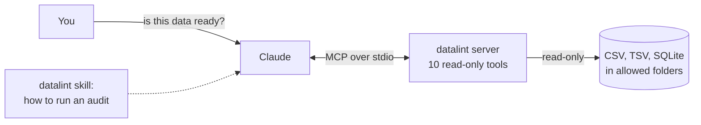

# datalint-mcp

[](https://github.com/asma-hachaichi/datalint-mcp/actions/workflows/tests.yml)

**Let Claude audit your data before you trust it.** datalint is an MCP server and Claude
skill. Point Claude at a CSV file or a SQLite database and ask "is this ready for training?" or
"can I trust revenue numbers built on this?". Claude profiles the data and finds missing
values, duplicates, outliers, broken keys, orphaned references and personal data. Then it tells
you what to fix, worst problem first, without ever putting personal data into the conversation.

<!-- mcp-name: io.github.asma-hachaichi/datalint-mcp -->

## Install

The server runs with [uv](https://docs.astral.sh/uv/), so install that first.

**Claude Code** (the plugin brings the server and the skill together):

```shell
/plugin install datalint --marketplace asma-hachaichi/datalint-mcp
```

On versions before Claude Code 2.1.275, add the marketplace first:

```shell
claude plugin marketplace add asma-hachaichi/datalint-mcp
claude plugin install datalint@datalint-mcp
```

The plugin lets the server read your current project folder, and nothing outside it.

**claude.ai or Claude Desktop:** go to Customize > Plugins > Add > Add marketplace and enter
`asma-hachaichi/datalint-mcp`. The server runs on your computer, so it works in Claude Code
and Cowork on desktop, not in web chat.

**Any other MCP client:** run `uvx datalint-mcp` over stdio and set `DATALINT_ROOTS` to the
folders it may read:

```json
{
  "mcpServers": {
    "datalint": {
      "command": "uvx",
      "args": ["datalint-mcp"],
      "env": { "DATALINT_ROOTS": "/path/to/your/data" }
    }
  }
}
```

## What to ask

- "Audit `customers.csv` for duplicates before I import it into our CRM."
- "Check `store.sqlite`. Can I trust revenue-per-customer numbers built on it?"
- "I want to send `contacts.csv` to an outside agency. Audit it first."
- "Can I use `line_id` as the primary key of `order_lines.csv`?"

Here is what the server returned when Claude checked the example database's orders for
references to customers that don't exist (abridged):

```json
{
  "column": "customer_id",
  "references": "customers.id",
  "basis": "declared",
  "rows_checked": 11,
  "orphans": 2,
  "orphans_pct": 18.18,
  "orphan_row_numbers": [5, 10],
  "orphan_examples": ["7", "9"]
}
```

## How it works



The **server** does the measuring: exact counts, row numbers, ranges. The
[**skill**](https://github.com/asma-hachaichi/datalint-mcp/blob/main/skills/datalint/SKILL.md)
tells Claude which checks to run and when, what to skip, and how to report: a verdict first,
then problems most serious first, each with real numbers and a concrete fix.

| Tool | What it answers |
|---|---|
| `load_dataset` | Loads a CSV, TSV or SQLite file. A database loads every table, with its declared foreign keys |
| `list_datasets` | Which datasets are loaded, and their size |
| `profile_dataset` | One overview per column: real type, missing values, distinct values, personal data |
| `describe_column` | A close look at one column: statistics, lengths, common values, formatting problems |
| `check_missing` | Where values are missing, including disguised ones like `"N/A"` or `"-"` |
| `find_duplicates` | Exact duplicate rows, duplicates on key columns, and rows that differ only by case or spacing |
| `find_outliers` | Numbers far outside a column's usual range (interquartile range or z-score) |
| `check_keys` | Whether a column, or a set of columns, uniquely identifies every row |
| `check_references` | Orphans: values that point at rows missing from another table |
| `detect_pii` | Columns holding emails, phone numbers, card numbers, IBANs, IP addresses, names and more |

## Safety by design

- **It only reads folders you allow.** Paths outside `DATALINT_ROOTS` are refused with a reason.
  Without the setting, the server can read only the folder it starts in.
- **It never changes your data.** Databases are opened read-only.
- **It keeps personal data out of the conversation.** Columns that look like personal data are
  flagged, and no tool ever returns their values. Card numbers and IBANs are confirmed with
  their checksums, so random IDs aren't mistaken for them.
- **It never echoes whole rows.** Duplicate and reference checks return row numbers, not values.
- **It's honest about cut output.** Long lists are paged, and every page says how many items
  exist and where the next page starts.

## Evals: does Claude actually use the tools well?

Unit tests prove each tool returns the right numbers. They can't prove that a model, reading
only the tool descriptions and the skill, picks the right tools and reports what matters. The
eval suite checks that: a real Claude model audits datasets with planted problems through the
real server over stdio, and its final report is scored.

| Scenario | Planted problem | The report must |
|---|---|---|
| `duplicate_customers` | 3 exact duplicate rows, 2 that differ only by case or spacing | count the exact copies and mention the near-duplicates |
| `disguised_missing` | 9 incomes written as `N/A`, `-` or `unknown`, plus 3 blanks | name the column, the placeholder and the size of the gap |
| `orphaned_orders` | 4 orders pointing at customers that don't exist (SQLite) | count them and point at a row |
| `extreme_outlier` | a 999 °C reading among room temperatures | give the value and its row |
| `personal_data` | names, emails and phone numbers | flag them, and never let one appear in the transcript |
| `clean_data` | nothing | say it's ready, without inventing duplicates, outliers or orphans |
| `bad_key` | a primary key reused on 2 rows | answer no, and say which values repeat |

Each run is also scored on calling the right tool and staying within a tool-call budget.
The checks are plain patterns, not an LLM judge, so scores are cheap and repeatable.
Tests confirm the datalint tools find exactly the planted problems, so a failed eval always
points at the model's behaviour, not at broken test data.

## Development

```powershell
python -m venv .venv
.venv\Scripts\pip install -e ".[dev]"
.venv\Scripts\python -m pytest
```

Run the evals (each run calls the Claude API and costs money; the summary shows how much):

```powershell
.venv\Scripts\pip install -e ".[eval]"
$env:ANTHROPIC_API_KEY = "<your key>"
.venv\Scripts\python -m evals                      # every scenario, on claude-opus-5-5
.venv\Scripts\python -m evals --scenario bad_key --repeat 3
```

On GitHub, unit tests run on every push and pull request. The **evals** workflow runs only when
started by hand, and needs an `ANTHROPIC_API_KEY` repository secret. Pushing a tag like `v0.1.0`
runs the **release** workflow, which publishes to PyPI and then to the MCP Registry.

To try it on sample data, allow the `examples` folder and ask Claude to audit
`customers.csv` or `shop.sqlite`.
[`make_shop_db.py`](https://github.com/asma-hachaichi/datalint-mcp/blob/main/examples/make_shop_db.py)
rebuilds the database and lists every planted problem.

## License

MIT
